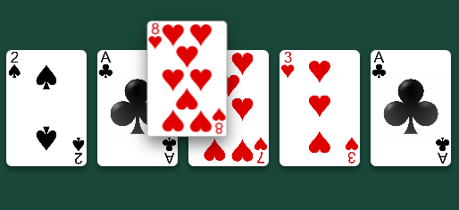
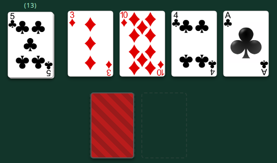

# Racing Demons

This project was born out of a desire to impress my partner's family. They are avid fans of a game called **Racing Demons** (also known as **Nertz** or **Pounce**); meanwhile the most intense card game I had played to date was Go Fish and War. I tried to search up an online version so I could practice, but the implementations I found had different rules from how they played it. Rather than build the skills for a similar but nonetheless different game, I decided to code my own implementation. It is built with vanilla JavaScript, HTML5, and CSS3. Race against three AI opponents-Derek, Kiera, and Tina- to be the one to place the most cards. This project was made with the assistance of AI.

To play, go to <https://theresapelosi.github.io/racing-demons>.

---
## How to Play

The game is a competitive Solitaire game. To place a card, it must be placed on a card of the same suit and one value lower. The ordering is A→2→3→4→5→6→7→8→9→10→J→Q→K. Aces can be placed at any time as they are the lowest value card. Once a king has been placed, no more cards can be placed on that pile.

  

The goal is to place as many cards as possible. There are three places to draw cards from: the demon pile, the visible cards or "working" pile, and the player's hand. The sum of these is 52 cards, a complete deck. 13 cards will be in the demon pile, 4 in the working pile, and the remaining 35 in the player's hand. When a card is placed from the demon pile or working pile, a card from the demon pile will be moved to replace it. Once the demon pile for any player reaches zero, the round is over.

  

In order to get cards from the player's hand, cards must be flipped three at a time. The player can only draw from the topmost card of the flipped stack. When all cards have been flipped, the cards are placed back into a player's hand and the topmost card is placed on the bottom (so that the cards are cycled rather than showing the same 1/3 of the deck each time).

The person with the most points after five rounds wins!

---

## Features

- **Real-Time Multiplayer Simulation:** Play simultaneously against three AI bots with selectable difficulty levels (**Easy**, **Medium**, and **Hard**).
- **5-Round Match Format:** Track cumulative scores across 5 rounds with automatic round-end overlays and live opponent Demon-pile counters.
- **Automatically Cycle Cards After Recycle:** Once you run out of cards in your hand, collect your flipped pile and place the topmost card to the bottom.
- **First Player Out Gets No Bonus:** The first player to deplete their demon pile receives no points bonus. Points are only calculated as cards played.

I regret to inform the reader that shuffling and points calculation are both done automatically by the computer, thus no intricate rituals can be performed by the user. This feature may be added in the future if there is sufficient interest.

---

## Tech Stack

- **HTML5** - Semantic structure and viewport configuration
- **CSS3** - CSS Grid, Flexbox, custom properties, and keyframe transitions
- **Vanilla JavaScript (ES6+ Modules)** - Modular state management, AI bot decision timers, and DOM rendering with zero external dependencies
- **Gemini 4** - Assistance with rendering and drag and drop functionality
